# The AI Engineering Organization — Blueprint & Drop-in Kit

**A complete engineering organization run by LLM agents — architecture,
product, project management, development, quality, security, compliance,
metrics and deployment — auditable end to end, and governed by the humans it
amplifies.** The status wall is just its visible surface.

> [!CAUTION]
> **Read this before adopting: this is a kit and blueprint for a complete
> engineering team run by AI — and that is precisely why this notice exists.**
>
> The author does **not** endorse using it to replace human decision makers,
> builders, architects, designers, project or program managers, engineering
> leaders, or any other role — specifically or arbitrarily. Every gate in
> this kit that routes to "the engineer" exists because a human owns that
> call, and removing the human removes the safety property, not just the
> person.
>
> **The recommendation:** review this kit and blueprint with your existing
> team, and use these tools to help that team deliver and support quality,
> secure, scalable, enterprise-grade products — an amplifier for the people
> accountable for the work, not a substitute for them.

> [!NOTE]
> **This repository is the kit's public showcase.** It carries the interactive
> demo, a rendered sample wall, screenshots and the architecture diagrams. The
> kit itself (its tooling, role sheets, templates and process documents) is
> developed in a private repository; its current version is not published here.

---

## What it is

A dependency-free scaffold (stdlib Python, plain HTML and CSS, no network
calls, no build step) that drops into an empty repository, or an existing one,
and stands up an engineering organization run by LLM agents: architecture,
project management, product management, design, development, quality,
security and deployment as one written, auditable, closed-loop process. The
human engineer supplies effort variables, product answers and the handful of
consent decisions no agent may make.

It is built to answer the complaints engineers actually have about
AI-assisted delivery:

| Complaint | What the kit does about it |
|---|---|
| "Nobody supports it after it ships" | The loop never ends: waves, findings graduating into rules, a failure registry that makes the next wave smarter than the last |
| "AI code quality is a coin flip" | A cold-read reviewer, tiered tests with a mutation protocol that proves tests can fail, one shared body of criteria for every grader |
| "It won't live past its author" | Everything is written state: ledger, decisions, briefs, wave reports. A new session, human or LLM, resumes from disk, not from memory |
| "It doesn't scale" | Parallel leased builders, serial integration, measured capacity rebalancing |
| "You can't audit what the AI did" | An append-only, byte-reproducible event ledger; every criterion cites its source; every decision is a record |
| "You can't undo it" | Append-only with supersession everywhere; rollback anchors before every force-push; consent prints before every system change |
| "Security is an afterthought" | SAST and secrets scanning in the definition of done, a gated network, localhost-only surfaces, security escalations straight to the sponsor |
| "It can't pass compliance" | The mechanisms map onto the control families auditors ask about: segregation of duties, change control, traceability |

## The organization, on one page


| Role (org term) | Kit carrier | Function |
|---|---|---|
| Product owner / sponsor | The driving engineer, **the Patron** | Effort variables, product answers, ceilings, ratifications and every consent decision |
| Engineering manager | **Maestro** (the session) | Dispatch, capacity within caps, merge authority, process |
| Program / portfolio lead | **Program lead** (one per engineer) | Product direction and priorities across repositories; never takes a Patron consent decision |
| Machine operations | **Fleet operator** (one per machine) | Observes resources and services; recommends with numbers; applies only reversible, lower-only changes |
| PMO / metrics | **Foreman** and the Wall | Measured status and integrity; throughput and cost counted from the ledger, never asserted by an agent |
| Solution architect | **Architect** | Domain design, arcs and stories, requirements sign-off, rulings |
| Governance board | **Adjudicator** | Tie-breaks, decision conflicts, contested trade-offs |
| Security & compliance | **Warden** (exactly one) | Architecture sign-off, data-use verdicts, delivery audit; blocks autonomously, never grants |
| Analysts | **Researchers** | Evidence with sources, options with costs |
| Engineers | **Builders** | Implementation in leased scopes, tests owed |
| Release engineer | **Integrator** | Rebase, safety proof, gates last, one PR per unit |
| QA / code review | **Reviewer** and external lanes | Cold diff read, mutation protocol, definition-of-done gate |

The same system as sessions, hooks and state, with what runs in parallel and
what runs in sequence:


More in [`docs/diagrams/`](docs/diagrams/):
[architecture](docs/diagrams/ARCHITECTURE.md),
[agent topology](docs/diagrams/AGENT_TOPOLOGY.md) and
[org mapping](docs/diagrams/ORG_MAPPING.md).

## See it

### The interactive demo

[`demo/wallkit-demo.html`](demo/wallkit-demo.html) is one self-contained file:
no build step, no network calls, no external assets. Download it and open it in
a browser. A scripted 180-minute wave of agent events folds into the wall the
way the real courier folds event shards. You can scrub the wave clock, move
between all nine tabs, answer a parked question and dispatch a ready item. See
[`demo/README.md`](demo/README.md) to embed it in a page.

### The sample wall

[`sample/.wall/`](sample/.wall/) is a rendered sample deployment, made from
fake event shards with zero model calls. It deliberately carries integrity
problems, so the wall shows how it reports them. The page reads `wall.json`
beside it, so serve the folder rather than opening the file:

```bash
python3 -m http.server 8000 --bind 127.0.0.1 --directory sample/.wall/derived
# then open http://127.0.0.1:8000/wall.html
```

### The wall, screen by screen

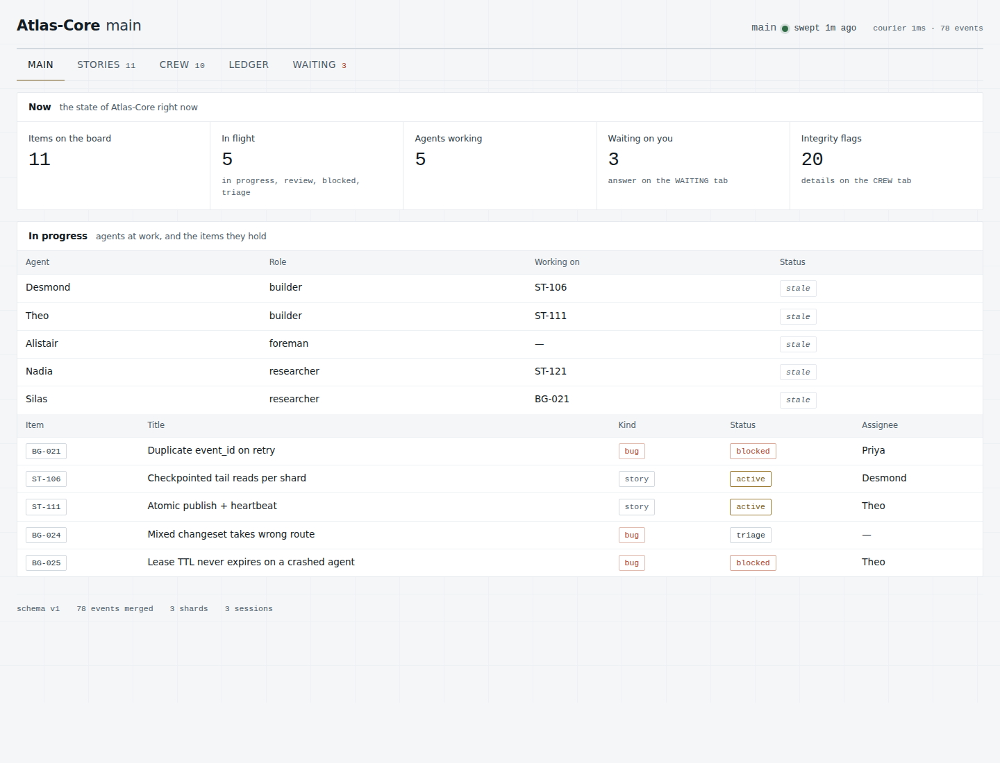

| | |
|---|---|
| 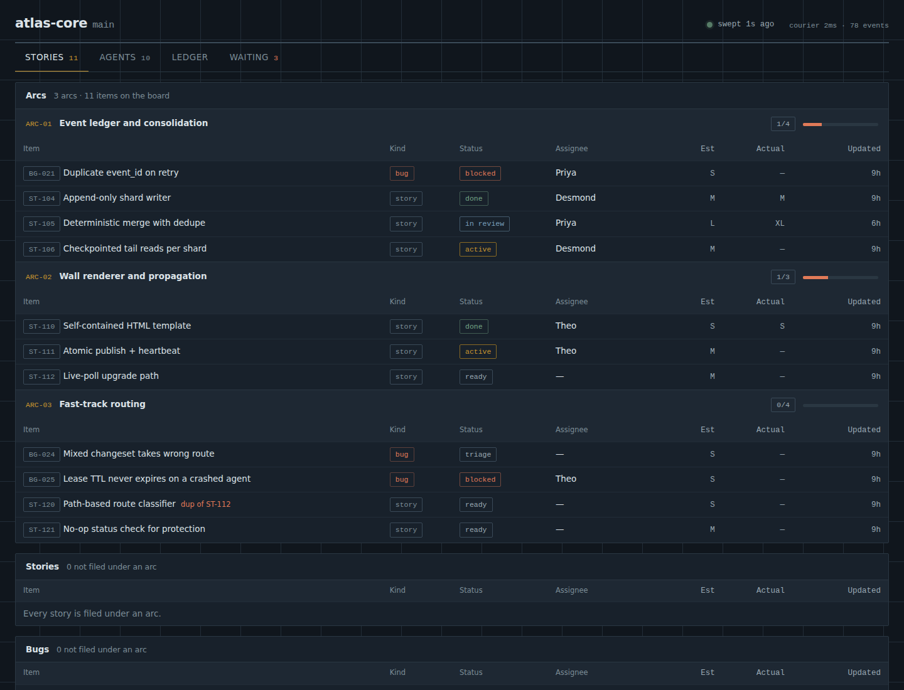 | 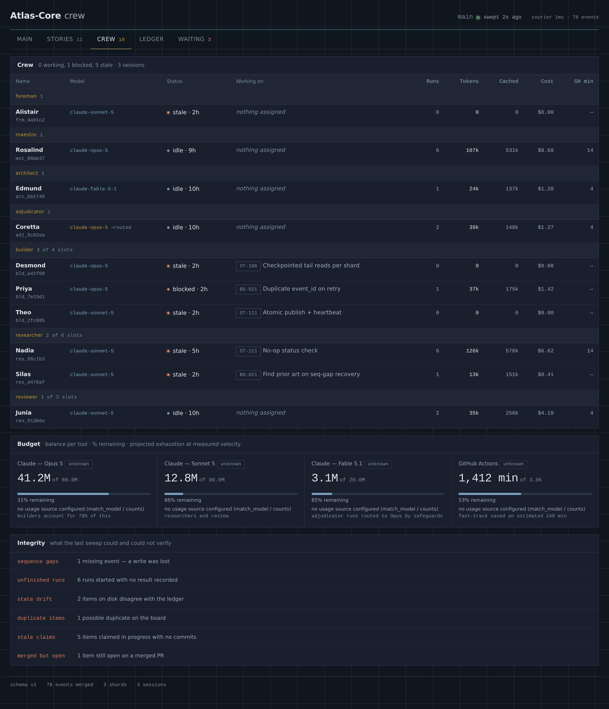 |
| **STORIES**: arcs with their stories and bugs, literal status chips, and a drill-in on every blocked item | **CREW**: names and keys, models, tokens and cost, budget trajectory, integrity flags |
| 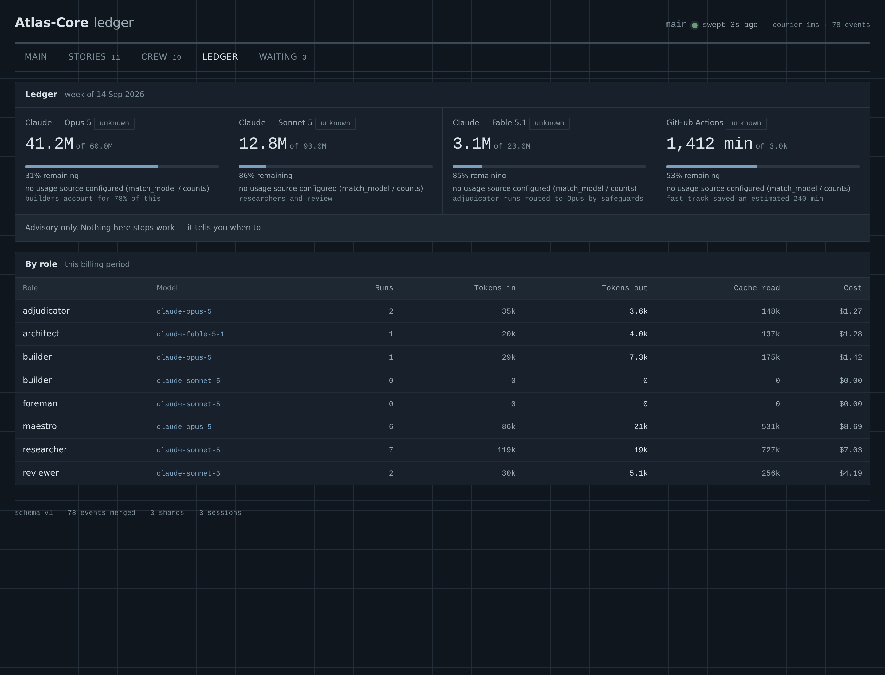 | 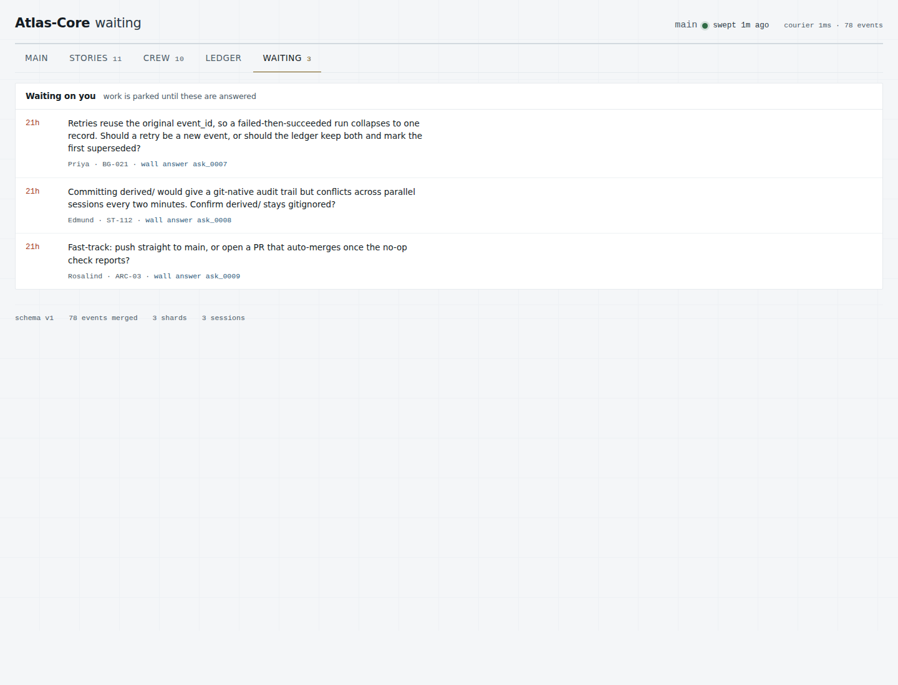 |
| **LEDGER**: per-tool budget gauges with pace and projected exhaustion, and the per-role cost rollup, counted from run events | **WAITING**: every ask that needs a human, with the command that answers it |
| 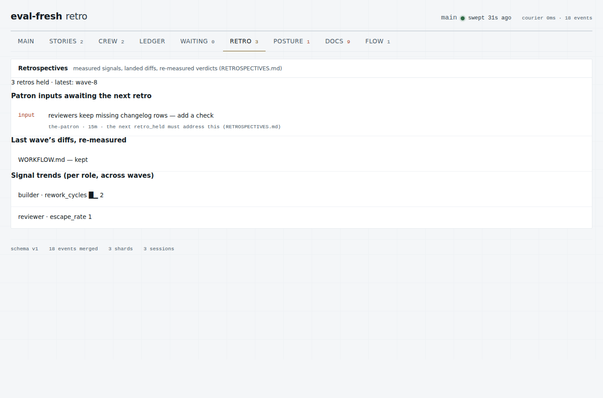 | 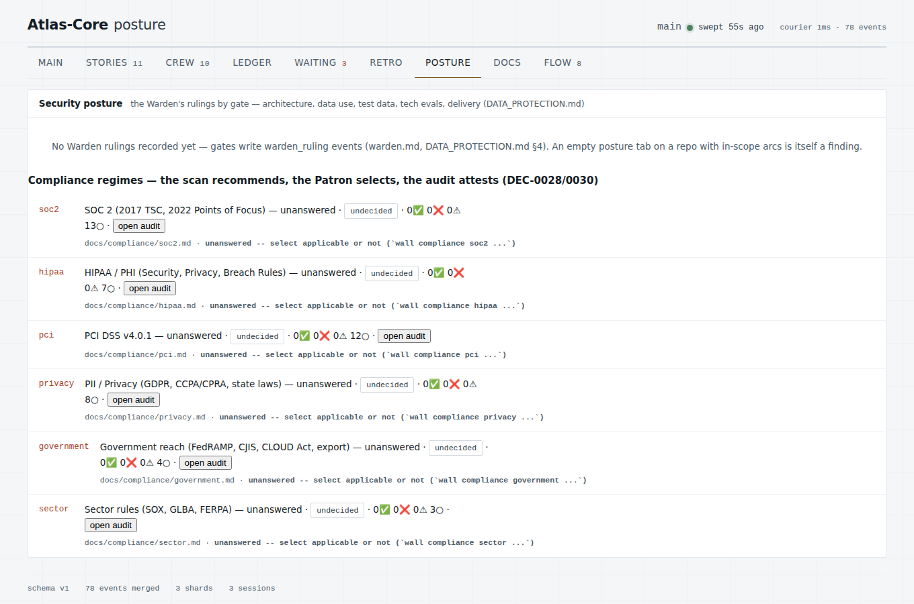 |
| **RETRO**: signal trends across waves, landed diffs re-measured, and the inputs the next retro must address | **POSTURE**: the Warden's latest ruling per subject, and the compliance regimes with their selections and challenges |
| 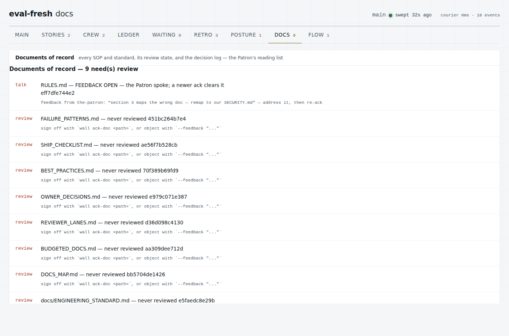 | 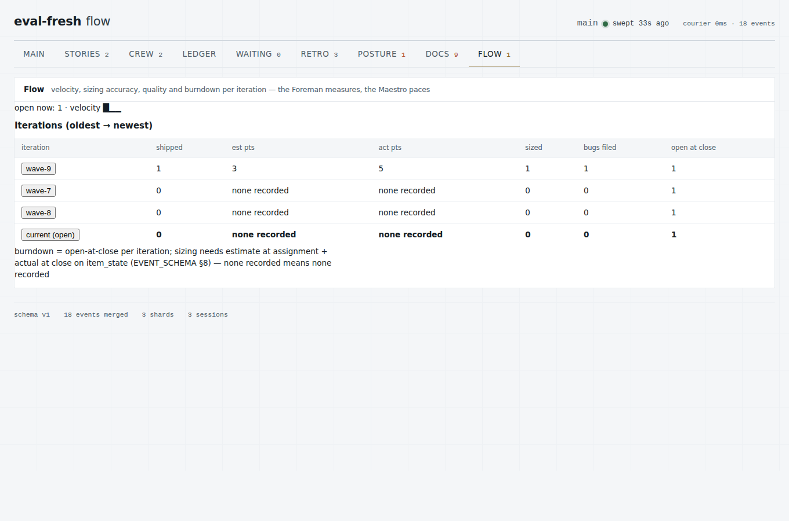 |
| **DOCS**: every standard at its sha, reviewed, changed or never reviewed, readable and approvable in place | **FLOW**: per-iteration shipped work, estimate against actual, bugs filed, burndown |
| 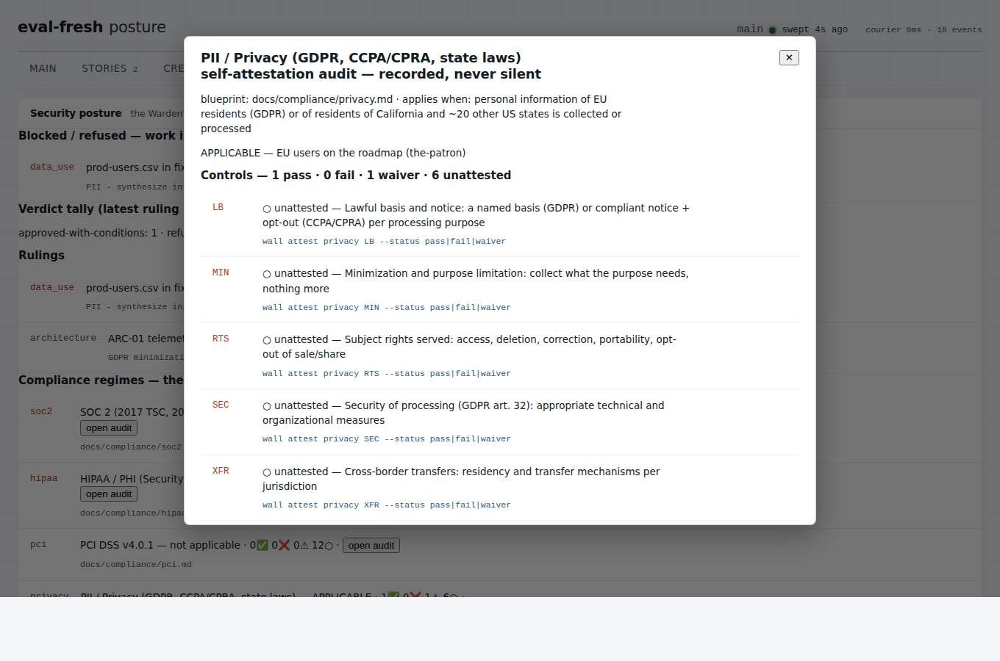 | 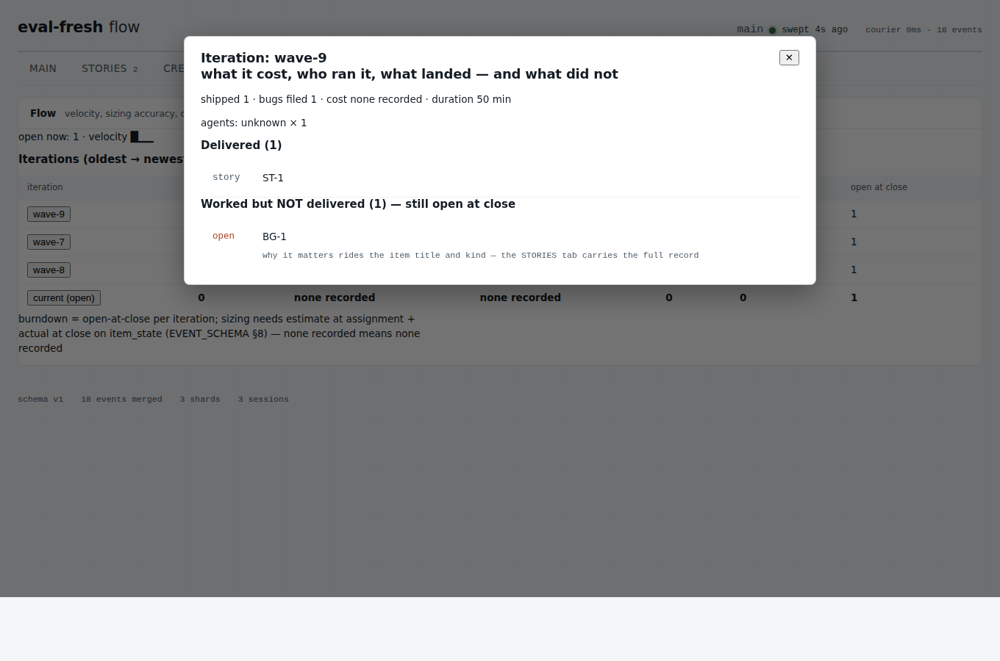 |
| **The audit popout**: per regime, every control's pass, fail or waiver with its note | **The iteration popout**: cost, agents by role, duration, delivered and not delivered |

Also in [`docs/screenshots/`](docs/screenshots/): the blocked drill-in, the
honest-degrade banner for a malformed snapshot, light mode, and the
status-vocabulary fixture.

## The idea

The kit is best read as a falsifiable claim: that most of an engineering
organization's *procedure* can be written down precisely enough for agents to
execute, that the parts which cannot be written down are exactly the parts
that need humans, and that the boundary between the two should be found by
measurement. Every rule in it cites the incident that taught it.
